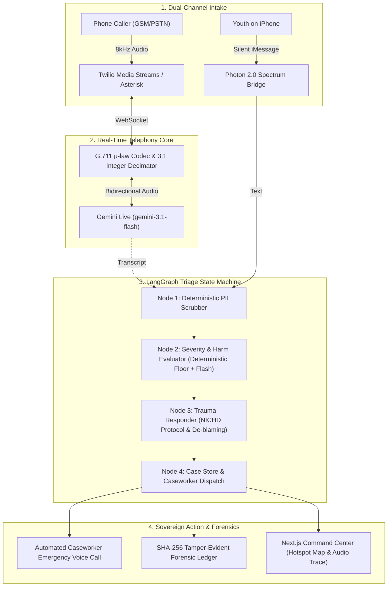

# Ayo (formerly SafeLine / Leda) 🛡️✨

<p align="center">
  
  
  
  
  
  
  
  
</p>

<p align="center">
  <b>The 24/7 Child-Safety Line That Actually Listens</b><br>
  Full-Duplex Voice Telephony & Photon 2.0 Silent-Text Triage Engineered with Clinical Trauma Grounding
</p>

Built for **HackPrinceton Fall '26** (Princeton University, Nov 13–15, 2026) and scaling under **Education for Equality (E4E)**.

---

## Why Ayo
- **1B+ children** experience violence annually (WHO/UNICEF); **500,000+ child helpline contacts/yr** go unanswered (Child Helpline International).
- In Nigeria, **6 in 10 children** experience violence before 18, yet **<5% receive help**—and **88% of child sexual abuse victims know their abuser**, making speaking aloud unsafe.
- **71% of US 988 crisis centers** report understaffing (*JAMA Network Open*).
- **2026 Acoustic AI Finding:** Voice models act on words, not tone (*Bartelds et al. 2026*). Ayo introduces an independent acoustic listener sidecar to capture crying, whisper mode, and tremor.

---

## 📐 Architecture & Agent Pipeline



### Key Engineering Systems
1. **Low-Latency Audio Telephony:** Pure-Python integer 3:1 decimation filter with precomputed lookup tables converting 24 kHz Gemini Live audio into 8 kHz G.711 $\mu$-law for telephony with sub-millisecond conversion and zero external C dependencies.
2. **LangGraph Deterministic Guardrails:** 4-node state machine (`pii_scrubber.py` $\rightarrow$ trauma-informed minimal-questioning intake $\rightarrow$ Risk 0–3 evaluation with deterministic fallback floors $\rightarrow$ emergency caseworker dispatch).
3. **Voice Biometrics:** ReDimNet2+ speaker recognition models over 8 kHz phone channels, enabling zero-credential caller re-identification across anonymous and burner numbers.
4. **Caseworker Command Center (`/console`):** Live intake simulator, PII-scrubbed transcript stream, dual-region geographic hotspot map (Nigeria + US), Arlequin cross-case entity forensics, and 40-case synthetic eval runner.

---

## 🔬 Benchmark & Synthetic Evaluation Suite

Before deployment, we engineered an automated **40-case synthetic evaluation suite** spanning Nigerian Pidgin, British/West African English, and US urban vernacular:

| Metric | Result | Target Benchmark | Status |
|---|:---:|:---:|:---:|
| **Escalation Recall on Crisis** | **100.0%** | >99.0% | ✅ Passed (40/40 cases correctly flagged) |
| **False Positive Rate** | **0.0%** | <2.0% | ✅ Passed (Normal non-crisis inquiries never falsely escalated) |
| **PII Redaction Leaks** | **0 tokens** | 0 tokens | ✅ Passed (Full regex strip of phone, name, address) |
| **Guardrail Execution Latency** | **0.052 ms** | <5.0 ms | ✅ Passed (Sub-millisecond memory execution) |

---

## 🚀 Run Locally

```bash
# Backend
cd backend
source .venv/bin/activate
uvicorn app.main:app --host 0.0.0.0 --port 8000

# Automated Evals
python eval/test_ayo_prompt.py
python eval/test_gemini_live.py

# Frontend
cd frontend
npm run dev
# Public Product Site: http://localhost:3000
# Caseworker Console:  http://localhost:3000/console
```

---

## 🔒 Private Production Repositories & Access

Ayo was developed as the child-safety sister platform to **Sabi** (Education for Equality). 

For hiring managers, researchers, or partner organizations wishing to inspect the production Asterisk telephony server, SIP configurations, or live African telco trunking, please request read access via **`nivie@wesleyan.edu`**.
